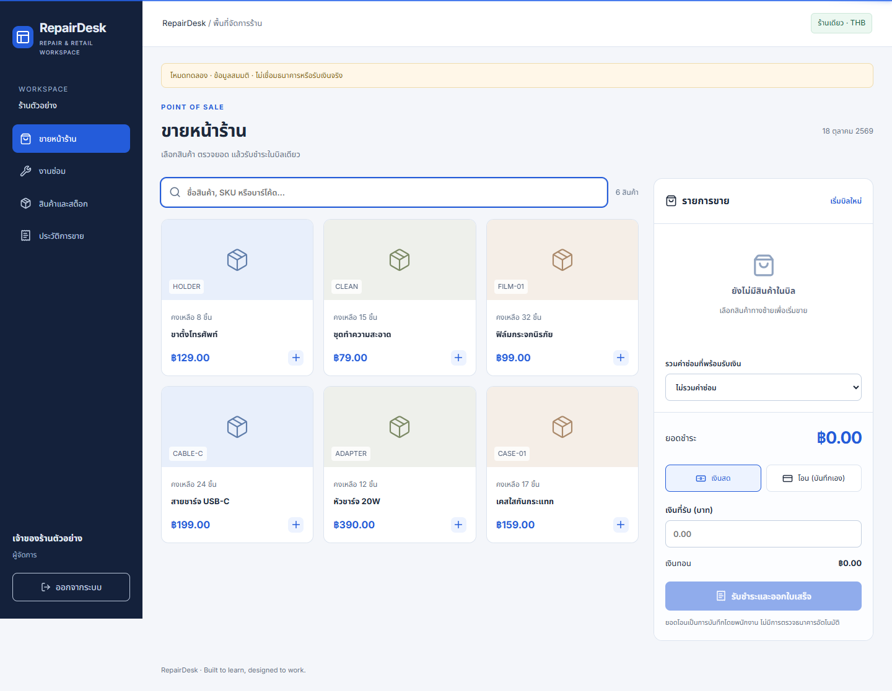

# RepairDesk

ระบบรับซ่อมมือถือและ POS ขายอุปกรณ์สำหรับร้านเดียว · **Laravel 13 · React 19 / Inertia 3 · TypeScript · SQLite / PostgreSQL**



## ลองใช้งาน

ต้องมี PHP 8.4+ พร้อม PDO SQLite, mbstring, intl, OpenSSL, Composer, Node.js 24+ และ npm

```sh
composer install
npm ci
cp .env.example .env
touch database/database.sqlite
php artisan key:generate
php artisan migrate --seed
npm run build
php artisan serve --host=127.0.0.1 --port=8005
```

Windows ใช้ `Copy-Item .env.example .env` และ `New-Item database/database.sqlite -ItemType File` แทนคำสั่ง copy/touch ข้างต้น หากใช้ PHP หลายรุ่น ให้เรียกด้วยพาธ PHP 8.4+ โดยตรง หรือกำหนด `$env:REPAIRDESK_PHP` แล้วรัน `./scripts/start-local.ps1` ไม่ต้องเปลี่ยน PHP ของ XAMPP เดิม

เปิด [แอปในเครื่อง](http://127.0.0.1:8005) บัญชีสมมติ: `manager@repairdesk.test`, `cashier@repairdesk.test`, `technician@repairdesk.test` รหัสผ่านทุกบัญชี `RepairDesk-demo-2026` เลือกบทบาทบนหน้า login เพื่อกรอกบัญชีได้ Seeder ปฏิเสธ environment production และไม่ใช้ข้อมูลลูกค้าจริง

## สิ่งที่ทำได้

- POS ค้นชื่อ/SKU/บาร์โค้ด เพิ่มตะกร้า รับเงินสดคำนวณเงินทอน หรือบันทึกยอดโอนที่พนักงานตรวจเอง
- Server คิดราคาเป็นสตางค์ ตัดสต็อกและสร้างบิลใน transaction กดส่งคำขอชำระเดิมซ้ำไม่สร้างบิลซ้ำ
- ผู้จัดการเพิ่มสินค้าและปรับสต็อกพร้อมเหตุผล/ผู้บันทึก ไม่ให้จำนวนติดลบ
- รับเครื่องซ่อม บันทึกลูกค้า อุปกรณ์ Serial/IMEI อาการ และมอบหมายช่างตอนรับเครื่อง
- บันทึกความคืบหน้า ประเมินราคา รับชำระและส่งมอบ มีประวัติงานและป้องกันการแก้ทับจากหน้าที่เก่า
- ประวัติการขาย ยอดรับชำระวันนี้ตามเวลาไทย และพิมพ์ใบเสร็จผ่าน browser print
- บทบาทผู้จัดการ/พนักงานขาย/ช่าง ตรวจสิทธิ์ที่เซิร์ฟเวอร์ ช่างดูเฉพาะงานที่ได้รับมอบหมาย

เป็น MVP สำหรับเรียนรู้ ยังไม่มีคืนสินค้า/คืนเงิน เปิด–ปิดกะ สาขา บัญชีลูกค้าเช็คงานเอง เครื่องพิมพ์เฉพาะรุ่น หรือเชื่อมธนาคารจริง ใบเสร็จเป็นเอกสารตัวอย่าง ไม่ใช่ใบกำกับภาษี

## PostgreSQL

ตั้ง `DB_CONNECTION=pgsql`, `DB_HOST`, `DB_PORT`, `DB_DATABASE`, `DB_USERNAME`, `DB_PASSWORD` ใน `.env` แล้ว migrate ฐานข้อมูลใหม่ ข้อมูล SQLite ไม่ย้ายอัตโนมัติ ทดสอบ PostgreSQL และการแย่งซื้อสินค้าชิ้นสุดท้ายพร้อมกันใน GitHub Actions แยกจากฐานข้อมูลเดโม

## ทดสอบ

```sh
php artisan test
vendor/bin/pint --test
npm run build
npx playwright install chromium
# เปิด server ที่ 8005 ในอีก terminal ก่อน
npm run test:e2e
```

Browser tests ใช้ข้อมูลสมมติและสร้างรายการขาย/งานซ่อมเพิ่ม ให้รันบนฐานข้อมูลทดลองเท่านั้น รายละเอียดโครงสร้างและขอบเขตอยู่ใน [architecture](docs/architecture.md)

## Checkpoint / กู้คืน

หลัง commit โค้ดให้ working tree สะอาด:

```sh
node scripts/checkpoint.mjs my-checkpoint
php artisan repairdesk:backup-data
```

คำสั่งแรกสร้าง source archive และ SHA-256 manifest ใน `backups/` พร้อม Git tag ไม่มี `.env`, dependencies หรือฐานข้อมูล คำสั่งที่สองสร้าง SQLite snapshot ที่สอดคล้องกันใน `storage/app/private/backups/` ซึ่งไม่ขึ้น GitHub และมีข้อมูลส่วนตัวของร้าน สำหรับ PostgreSQL ใช้ `pg_dump` แยกต่างหาก

กู้โค้ดโดยแตก archive ลงโฟลเดอร์ใหม่ ตรวจ SHA-256 ติดตั้ง dependencies และสร้าง `.env`/app key ใหม่ หรือสร้าง branch จาก checkpoint tag หลีกเลี่ยง reset ทับงานปัจจุบัน กู้ SQLite โดยหยุด server และคัดลอก snapshot ไปยังไฟล์ฐานข้อมูลของสำเนาใหม่ก่อนตรวจยอด/จำนวนรายการ ไม่ทับฐานข้อมูลที่กำลังใช้งาน

## งานต่อไป

เพิ่มการคืนเงินด้วยรายการย้อนกลับ เปิด–ปิดกะ และพอร์ทัลติดตามงานลูกค้า หลังจากตรวจขั้นตอนขายและเงินคงเหลือร่วมกับผู้ใช้จริง
